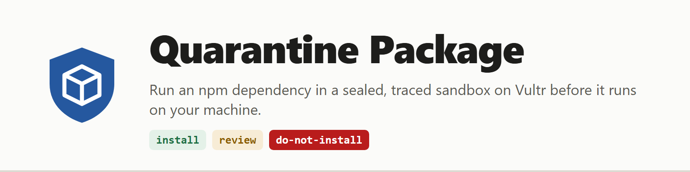
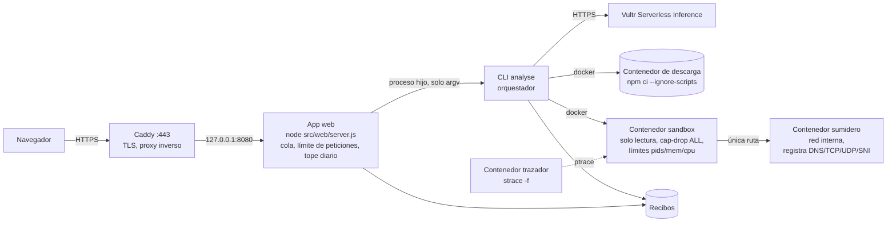

<h1 align="center">
  <picture>
    <source media="(prefers-color-scheme: dark)" srcset="docs/media/brand/banner-dark.png">
    
  </picture>
</h1>

<p align="center">
  
  
  
  <br>
  
  
  
  
  
  
  <br>
  
  
  
  
</p>

<p align="center"><a href="README.md">English</a> · <b>Español</b></p>

> Traducción del [README en inglés](README.md). Si algo no coincide, manda la versión en inglés.

Antes de añadir una dependencia de npm, escribe su nombre y versión. Quarantine Package la descarga **fuera** de
un sandbox sin ejecutar ningún script. Después la instala y la carga **dentro** de un sandbox desechable,
endurecido y trazado, cuya única red termina en un sumidero que lo registra todo. Obtienes un recibo público con
cada intento observado y un veredicto determinista: `install`, `review` o `do-not-install`.

Primero, un modelo en **Vultr Serverless Inference** lee el paquete. Predice qué hará (red, ficheros fuera de su
carpeta, procesos hijos) y escribe un pequeño harness que ejercita la API principal del paquete. El recibo pone
esa predicción junto a lo que realmente se observó. El veredicto nunca depende del modelo: lo calculan reglas
fijas a partir de la traza del kernel y del registro del sumidero.

**Vídeo de la demo (3:16):** https://youtu.be/KqVSzqyXf-o · **Diapositivas:** [PDF](docs/media/submission/quarantine-package-slides.pdf) · **Demo en vivo:** https://qp.hugovaler.com (una VM de Vultr). Recibos de ejemplo:
[express → install](https://qp.hugovaler.com/r/514e574600) ·
[fastify → install](https://qp.hugovaler.com/r/d6fbf70332) ·
[demo de red → review](https://qp.hugovaler.com/r/d5af19b228) ·
[paquete hostil → do-not-install](https://qp.hugovaler.com/r/8b42cfb93e) ·
[fork bomb](https://qp.hugovaler.com/r/93b65a40ad) y [bucle infinito](https://qp.hugovaler.com/r/7480a24604) → do-not-install.
Con el «What happened» del modelo: [express](https://qp.hugovaler.com/r/42f7249f48). Cada recibo se exporta
también como Markdown ([ejemplo](https://qp.hugovaler.com/r/8b42cfb93e.md)), JSON y
[SARIF](https://qp.hugovaler.com/api/receipts/8b42cfb93e.sarif) ([Usar el resultado](#usar-el-resultado)).

## El caso de uso y cómo ejecuta el agente tareas reales

Los ataques a la cadena de suministro se esconden en los scripts de instalación y en el código que se ejecuta al
cargar: leen tokens, escriben en rutas del sistema y envían datos fuera. Leer el código no te dice qué hará;
ejecutarlo en tu máquina es justamente el riesgo.

Para cada petición, el sistema hace lo siguiente:

1. **Descarga fuera del sandbox.** `npm` resuelve y descarga el árbol exacto con `--ignore-scripts`, con
   límites de tamaño, de número de dependencias y de tiempo. Solo se admiten dependencias del registro (nada de
   git, URL ni rutas de fichero).
2. **Paso del modelo (Vultr Serverless Inference).** El modelo recibe los metadatos del paquete y extractos del
   README y del punto de entrada. Nunca recibe el entorno del host. Devuelve una predicción, un harness y una
   breve explicación.
3. **Ejecución en un sandbox nuevo.** El contenedor tiene la raíz de solo lectura, un tmpfs propiedad de su
   propio uid, `cap-drop ALL`, `no-new-privileges`, un usuario no root, límites de pids, memoria y CPU, y un
   tiempo máximo que se impone con `docker kill`.
   - Ejecuta `npm rebuild --offline` (los scripts de instalación), después el propio `require()` del producto
     sobre el paquete y, por último, el harness del modelo.
   - Un contenedor trazador aparte sigue las llamadas al sistema de ficheros, procesos, red y tabla de
     descriptores del paquete con `strace` (el conjunto completo y por qué: [`docs/TRACE-SET.md`](docs/TRACE-SET.md)).
   - La única red del sandbox es una red interna de Docker en la que toda ruta y toda respuesta DNS acaba en el
     sumidero. Eso cubre TCP por nombre y por IP directa, UDP y DNS.
4. **Decisión.** Reglas fijas convierten las observaciones en un veredicto: por ejemplo, una escritura fuera de
   las zonas permitidas, la lectura de una ruta de credenciales o de una variable de entorno con pinta de clave,
   o un intento de red que lleva datos. Si falla alguna comprobación de completitud, la traza se considera
   incompleta y el veredicto es, como poco, `review`.
5. **Destrucción.** Se eliminan todos los contenedores, redes y volúmenes de la tarea. El recibo deja constancia
   de que no queda nada.
6. **Explicación (informativa).** Una segunda llamada al modelo describe lo que pasó, a partir de un resumen
   construido por código. Una guarda fija sustituye cualquier respuesta que contradiga el veredicto por una frase
   construida por código ([Los dos textos del modelo](#los-dos-textos-del-modelo)). En ese momento el veredicto
   ya está escrito.

## Servicios de Vultr utilizados

| Servicio | Qué hace aquí |
|---|---|
| **Vultr Cloud Compute (VM)** | Todo el backend: la aplicación web (detrás de Caddy con TLS), la cola de trabajos, Docker con los contenedores de sandbox, trazador y sumidero, y los recibos. Vultr es donde se controla y ejecuta cada tarea, no un simple alojamiento estático. |
| **Vultr Serverless Inference** | Todas las llamadas LLM: el endpoint compatible con OpenAI `https://api.vultrinference.com/v1`, modelo por defecto `mimo-v2.6-pro`, alternativo `deepseek-v4.1-flash-1017`. La clave (`VULTR_INFERENCE_KEY`) solo la lee el proceso del backend y solo se envía en la cabecera `Authorization`. Nunca se registra en logs, ni se pone en un recibo, ni se envía al navegador, ni entra en un sandbox. |

## Arquitectura



Todo lo anterior corre en una sola VM de Vultr. Solo Caddy está expuesto, en los puertos 80 y 443. La app web
escucha en `127.0.0.1:8080`. La red del sandbox es `--internal`, así que no tiene ruta a internet: el sumidero
es el único sitio al que puede llegar el tráfico de un paquete.

**Aislamiento: hoy, Docker endurecido; gVisor es trabajo futuro.** El sandbox es Docker endurecido (runc: raíz de solo lectura, sin capacidades, no root, límites de pids/memoria/CPU y de tiempo) con strace a nivel de kernel como red de seguridad. Ejecutarlo con gVisor (runsc) es trabajo futuro: con runsc, las llamadas al sistema del paquete las atiende el kernel de espacio de usuario de gVisor, no el del host, así que la observación tendría que pasar a los puntos de traza propios de gVisor, y aún no hemos comprobado que así se conserven todas las observaciones que necesita el veredicto.

**Fronteras de confianza:**
- **No confiable:** los paquetes y todo lo que imprimen o escriben, y la salida del modelo. Todo eso solo se observa, se escapa y se juzga con reglas fijas.
- **Superficie pública:** desde internet solo se llega a Caddy. La app web acepta un `name@version` validado o el id de una demo, y se lo pasa a la CLI como argv, nunca a través de una shell. No tiene rutas de administración ni de Docker.
- **El usuario del backend puede manejar Docker (L-14).** El usuario de servicio `qp` está en el grupo `docker`, que equivale a root, así que comprometer el proceso web sería comprometer el host.
  - Mitigaciones: la superficie de ataque reducida descrita arriba; el endurecimiento de systemd (`NoNewPrivileges`, `ProtectSystem`, `ProtectHome`, `PrivateTmp`); la app escuchando en `127.0.0.1` detrás de Caddy; y la clave del modelo guardada en un `EnvironmentFile` legible solo por root.
  - Docker rootless o un proxy del socket de Docker que solo permita las llamadas necesarias es trabajo futuro.

Pasos de despliegue: [`docs/DEPLOY.md`](docs/DEPLOY.md). Detalles de la interfaz: [`docs/CONTRACT.md`](docs/CONTRACT.md).

## Dónde se ve la contención

Ejecuta la tarjeta de demo **«Hostile package»** de la página de inicio (un fixture del repositorio, nunca
publicado). Su script de instalación intenta:
- escribir en `/etc` y en el directorio home;
- buscar `docker.sock`;
- contar variables de entorno con pinta de clave;
- hacer `POST` de datos a `recolector.example.com`.

El recibo muestra:
- el veredicto **`do-not-install`**, con cada intento listado y la regla que activó;
- el intento de exfiltración **solo en el registro del sumidero**, con método, ruta y tamaño de los datos; nada
  salió de la VM;
- **«Sandbox destroyed: yes»**.

`/healthz` sigue respondiendo durante la ejecución, y el siguiente análisis corre en un sandbox nuevo.

Hay dos demos de contención más en la página de inicio, ambas fixtures del repositorio: una **fork bomb** que
para el límite de pids en unos 7 s ([recibo](https://qp.hugovaler.com/r/93b65a40ad)) y un **bucle infinito** que
mata el tiempo máximo de 60 s ([recibo](https://qp.hugovaler.com/r/7480a24604)). Las dos obtienen
`do-not-install` (regla `e`, tarea terminada por un límite) y no dejan nada detrás.

[`docs/DEMO.md`](docs/DEMO.md) es el guion de la demo paso a paso.

## Probado con dependencias reales

Tres dependencias de uno de los proyectos del autor (una app de pagos con Fastify y Stellar), ejecutadas en el
despliegue en vivo el 4 de noviembre de 2026:

| Paquete | Veredicto | Qué demuestra |
|---|---|---|
| `fastify@5.12.4` | [`install`](https://qp.hugovaler.com/r/d6fbf70332) en unos 9 s | Un framework de servidor real pasa: sin red, sin escrituras fuera de su carpeta, y la predicción del modelo coincide. |
| `esbuild@0.28.2` | [`review`](https://qp.hugovaler.com/r/ab40fb6263) | Un paquete que mantiene un binario nativo como proceso hijo de larga duración dispara una comprobación de completitud, así que falla hacia el lado seguro (L-16). |
| `@stellar/stellar-sdk@17.0.1` | abortado antes de ejecutarse | Su árbol supera el límite de descarga de 50 MB, así que no se ejecuta nada y no hay veredicto (L-17). |

## Instalación desde un clon limpio

**Requisitos:**
- Docker (Docker Engine en Linux, o Docker Desktop);
- Node.js 22.12 o posterior, con npm.

El producto no tiene dependencias de npm en tiempo de ejecución.

```sh
git clone https://github.com/hvaler/quarantine-package && cd quarantine-package
npm run build:images                          # imágenes qp-sandbox / qp-sinkhole (imágenes base fijadas por digest)
npm test                                      # tests unitarios (sin Docker, modelo falso)
node src/cli.js analyse express@4.21.2        # paquete del registro -> install
node src/cli.js analyse --fixture hostile     # fixture local        -> do-not-install
node src/cli.js leftovers                     # se espera count 0
node src/cli.js scan-secrets                  # búsqueda de patrones de secretos en el repo y los recibos
npm run web                                   # app web en http://127.0.0.1:8080
```

En un host Linux, la comprobación de rol del preload (H-1) degrada cualquier proceso de test que diga tener el rol
de harness. Por eso los tests unitarios de la fase del paquete (latch) solo detectan una regresión del latch en un
host que no sea Linux. Si cambias `preload.cjs` o `harness.cjs`, ejecuta también `npm test` en un host que no sea
Linux, o la suite S2 de ejecución.

Para usar el modelo, define `VULTR_INFERENCE_KEY` en el entorno del proceso que ejecuta la CLI o la app web. Sin
ella, todos los análisis se ejecutan igual y obtienen su veredicto; el recibo indica que el modelo no estaba
disponible. `node src/cli.js smoke-model --out evidence/c11-smoke.json` es el único comando que llama a propósito
al endpoint real. Medido en Vultr Serverless Inference (C11): el modelo respondió para 4 de 4 paquetes
(`express`, `lodash`, `chalk` y el fixture hostil), con latencias de 1,9 s a 4,7 s.

Los recibos se escriben en `./receipts/<taskId>.json` (se cambia con `QP_RECEIPTS_DIR`). Los objetos de Docker se
llaman `ar-<QP_RUN_PREFIX>-<role>-<taskId>`.

## Usar el resultado

Cada recibo está disponible en cuatro formas. Todas se construyen solo a partir del recibo guardado, así que los
recibos antiguos también las tienen, sin volver a ejecutar nada.

| Forma | Dónde | Para qué sirve |
|---|---|---|
| Página | `/r/<id>` | Para personas. Tiene un botón **Copy for PR**, un enlace **Download JSON** y enlaces a las dos formas siguientes. |
| JSON | `/api/receipts/<id>` | El recibo completo: cada observación, el registro del sumidero, los límites y la destrucción. |
| Markdown | `/r/<id>.md` (`text/markdown`) | Para pegar en un comentario de un pull request. Incluye el paquete y la versión, el veredicto, cada regla activada, la predicción frente a lo observado, el resumen del sumidero (host, método, ruta, bytes), «sandbox destroyed», las limitaciones aplicables y enlaces a la página y al JSON. |
| SARIF 2.1.0 | `/api/receipts/<id>.sarif` (`application/sarif+json`) | Herramientas de code scanning. |

Las formas Markdown y SARIF **no contienen texto del modelo**: son deterministas. Toda cadena que controla el
paquete (rutas, nombres de host, rutas de URL) aparece dentro de un bloque de código en línea, con los caracteres
de control, bidi y de ancho cero escritos como `\u{..}` y las cadenas largas recortadas. Así, un paquete no puede
falsificar una línea de veredicto, un enlace, una imagen, una mención ni HTML en tu comentario del PR. Define
`QP_PUBLIC_URL` (por ejemplo `https://qp.example.com`) para obtener enlaces absolutos.

**SARIF.** Hay una regla SARIF por cada regla de veredicto, de la `a` a la `i`, y un resultado por cada regla que
se activó. Todos los resultados toman el nivel del **veredicto**: `error` para `do-not-install` y `warning` para
`review`. Por eso un recibo `do-not-install` puede tener reglas del nivel `review` notificadas como `error`, y un
recibo `install` no tiene resultados. Cada mensaje indica el nivel propio de su regla (`Rule (f), tier review,
fired for …`). Cada resultado se sitúa en el `package.json` del paquete analizado, porque GitHub code scanning
exige una ubicación para cada resultado
([SARIF support for code scanning](https://docs.github.com/en/code-security/code-scanning/integrating-with-code-scanning/sarif-support-for-code-scanning)).
Los tests unitarios validan la salida contra el esquema JSON OASIS SARIF 2.1.0 errata01, incluido en `test/vendor/`
con su sha256. El validador es un pequeño validador draft-04 en esa misma carpeta, así que los tests no necesitan
red ni dependencias.

**CLI.** `node src/cli.js analyse <spec> --format json|md|sarif` escribe esa forma en stdout y además escribe el
fichero del recibo. `node src/cli.js export <receipt.json> --format json|md|sarif` convierte un recibo guardado.
`analyse` y `export` terminan con un código según el veredicto:

| Código | Significado |
|---|---|
| `0` | `install` |
| `10` | `review` |
| `20` | `do-not-install` |
| `2` | error de uso o entrada no válida (sin veredicto) |
| `3` | abortado en la fase de descarga, por ejemplo por una dependencia que no es del registro o por un límite de tamaño (sin veredicto) |
| `4` | fallo de infraestructura o trazador no disponible (sin veredicto) |
| `130` | interrumpido con Ctrl+C o `SIGTERM` (sin veredicto) |

Un paso de GitHub Actions que hace fallar el job ante `do-not-install`. Es solo un ejemplo; el runner necesita
Docker y un clon de este repositorio con las imágenes construidas.

```yaml
- name: Quarantine the new dependency
  run: |
    code=0; node src/cli.js analyse "lodash@4.17.21" --format md > qp.md || code=$?
    cat qp.md >> "$GITHUB_STEP_SUMMARY"
    if [ "$code" -eq 20 ]; then echo "::error::do-not-install"; exit 1; fi
    if [ "$code" -ne 0 ] && [ "$code" -ne 10 ]; then exit "$code"; fi
```

### Los dos textos del modelo

La página del recibo muestra dos textos escritos por el modelo. Ninguno puede cambiar el veredicto.

- **Model's expectation before the run** se escribe antes de que se ejecute el sandbox, a partir de los metadatos
  del paquete y de extractos del README y del punto de entrada. Va junto a la predicción y al harness.
- **What happened (model, informational)** se escribe después de calcular el veredicto y de destruir el sandbox.
  Sale de una segunda llamada a Vultr Serverless Inference. El modelo recibe un resumen construido por código: el
  veredicto, las reglas activadas, los recuentos por tipo de observación, hasta 8 observaciones representativas,
  el resumen del sumidero y la predicción frente a lo observado. Toda cadena que controla el paquete se limita de
  longitud y se pasa como dato entrecomillado dentro de un bloque JSON delimitado que el prompt declara no
  confiable. El redactor de secretos se aplica a la entrada y a la salida.

Una guarda fija revisa la respuesta. Ante cualquier duda, la sustituye por una frase construida por código a
partir del recibo, etiquetada como *code template*. La guarda rechaza una respuesta que:
- nombre un veredicto distinto del calculado;
- diga o insinúe seguro, inofensivo, limpio, sin riesgo o similares cuando el veredicto no sea `install`;
- cite la letra de una regla que no se activó;
- tenga más de 4 frases (`;` cuenta como corte), 90 palabras o 600 caracteres;
- contenga marcado, enlaces, saltos de línea o texto no ASCII después de normalizar;
- o venga de una llamada que falló o agotó el tiempo (20 s).

Además de esas comprobaciones, la guarda usa una **lista de permitidas**. Cada palabra de la respuesta debe estar
en un vocabulario descriptivo fijo de unas 409 palabras: ficheros, red, procesos, límites, predicción. Ese
vocabulario no tiene palabras de consejo, juicio ni veredicto. «install» solo se admite en «install script»,
«install hook» y similares. Así, «you can add it», «nothing to worry about» o «the rules overreacted» fallan
se digan como se digan, y lo mismo cualquier ruta o nombre de host citado. El prompt pide al modelo que los
describa de forma genérica.

Los nombres de método HTTP solo se aceptan delante de «request», como en «a GET request». Cuando el veredicto no
es `install`, se aplican dos comprobaciones más:
- cualquier negación (no, not, nothing, none, without) falla, porque podría quitar importancia a lo que se activó;
- la respuesta debe citar al menos una regla activada, por ejemplo `Rule (a) fired: …`, para que siga ligada al hallazgo.

El vocabulario también excluye palabras de contraste («but»), atenuantes («only», «just»), «error», y «npm» y
«harness», para que el acto no se pueda atribuir a otro que no sea el paquete.

**Ajustar el modelo a la guarda (S8).** La guarda no se relaja; al modelo se le dicen las reglas.
- **El prompt** le da al modelo las reglas exactas que aplica la guarda, incluida la lista completa de palabras. También le pide una forma fija: «Rule (x) fired:» y después frases en pasado sobre lo que hizo el paquete.
- **Un reintento.** Si la guarda rechaza la primera respuesta, se hace un reintento dentro del mismo presupuesto de 20 s. Solo lleva el código del motivo y las palabras problemáticas de la propia respuesta del modelo. Se descartan las palabras que aparezcan en cualquier cadena controlada por el paquete, y el texto rechazado nunca se le reenvía.
- **Respuestas truncadas.** Una respuesta cortada por el límite de tokens nunca se muestra.
- **Cambios de vocabulario.** Las palabras añadidas tras el diagnóstico con el endpoint real, y la única palabra eliminada, se listan con su evidencia en [`docs/L-20-vocabulary.md`](docs/L-20-vocabulary.md).
- **Textos rechazados.** Con `QP_LOG_REJECTED=1` (desactivado por defecto), las respuestas rechazadas van al stderr del proceso como una línea redactada de 1000 caracteres como máximo; el journal del servidor web la recoge. Nunca van a un recibo, una página, un `.md` ni un `.sarif`.

El recibo registra qué texto se usó y por qué (`outcomeExplanation.source` y `guard.reason`). Con
`QP_MODEL_OFF=1` siempre se usa la plantilla. `verdict.js` nunca lee este campo, y un test unitario lo comprueba.

Primero se escribe el recibo con el veredicto, con `outcomeExplanation.status: "pending"`. Después se hace la
llamada, y el fichero del recibo se sustituye de forma atómica por el resultado. El trabajo web termina cuando
termina la CLI, así que la página del trabajo enlaza al recibo final. Si la CLI se interrumpe durante la llamada,
el recibo conserva el veredicto y se queda en `pending`. Los recibos anteriores a esta función no tienen ese campo
y se muestran como antes.

## Límites por defecto

| Fase | Límite |
|---|---|
| Descarga | 120 s, 50 MB descomprimidos, 300 paquetes, solo dependencias del registro |
| Sandbox | 60 s de tiempo máximo, 64 pids, 256 MB de memoria (sin swap), 0,5 CPU, tmpfs de 128 MB en `/work`, 64 MB en `/tmp`, 16 MB en HOME |
| Web | concurrencia de la cola 1 (máx. 2), 5 análisis por cliente cada 10 min (IPv6 por /64), 30 cada 10 min en total, tope diario de llamadas al modelo |

## Detener una ejecución

Ctrl+C (o `SIGTERM`) detiene `analyse` en el acto. Elimina todos los contenedores, redes y volúmenes de la tarea
en 10 s, escribe un recibo con `abortReason: interrupted` y termina con 130. Un segundo Ctrl+C no se salta la
limpieza. Si la CLI muere de golpe, el vigilante de cada tarea elimina los objetos. Detener el servidor web
interrumpe sus tareas en curso de la misma forma.

## Depurar un veredicto

Define `QP_KEEP_TRACE=1` para conservar la traza de llamadas al sistema en bruto del sandbox como
`<taskId>.trace` junto al recibo. El recibo solo nombra el fichero. Las líneas que parecen secretos se redactan, y
`scan-secrets` revisa estos ficheros.

## Limitaciones conocidas

Cada recibo las lista en `knownLimitations`.
- **Fallan hacia el lado seguro:** la mayoría solo pueden endurecer un veredicto: `review` o `do-not-install`
  para algo benigno.
- **Dos excepciones:** L-1 y L-13 pueden pasar por alto la **lectura** de una clave que no deja rastro. L-13
  cubre también un addon nativo que use una llamada de ficheros que strace 6.1 no sabe nombrar (ver su fila).
  - El sandbox no contiene valores secretos, cosa que el escaneo C7 comprueba en cada ejecución.
  - Cualquier intento de enviar datos fuera lo sigue captando el sumidero con sus reglas.
  - Lo único que se pierde es la señal de «intentó leer una clave».

| Id | Limitación |
|---|---|
| L-1 | Las lecturas de variables de entorno dentro de la shell (`$NPM_TOKEN` expandido por un `sh` de ciclo de vida) son invisibles tanto para la traza del kernel como para el preload. `perl` y `awk` se han quitado de la imagen. La actividad de ficheros, red y procesos de la shell se sigue trazando y juzgando. |
| L-2 | Un ciclo de vida que ejecuta un script directamente desde `/work`, `/tmp` o HOME (`./install.sh`) obtiene `review`. Ahí la traza no puede distinguir un script de un binario ELF, así que falla hacia el lado seguro. |
| L-3 | Una dependencia que no es del registro y está en lo profundo del árbol se rechaza antes de descargarla. Para entonces ya se han descargado los metadatos del registro de las dependencias visitadas antes. |
| L-4 | No se inspecciona: ICMP ni el contenido TLS; solo se registra el SNI. El paquete puede ver el trazador. `execveat` solo está cubierto por tests unitarios. Las imágenes no se construyen de forma reproducible byte a byte, porque los paquetes de la distribución se instalan al construirlas. |
| L-6b | Cuando las operaciones de ficheros relativas de un hijo aparecen en la traza antes del retorno del clone de su padre, quedan sin resolver. Esas escrituras dan `do-not-install` y esas lecturas dan `review` (lado seguro). |
| L-7 | **Arreglado.** Un `chdir` de un hilo en carrera con un fork podía atribuir mal el directorio de trabajo de un hijo. Una regla estructural deja ahora sin resolver el directorio de ese hijo. Medido en ejecuciones reales: 0 fallos en 15 intentos reales en S1 y 0 en 3 en S2. Lo que queda son L-8 y L-8b. |
| L-8 | Cuando un hilo aún no atribuido a ningún proceso cambia de directorio durante un fork no relacionado, las rutas relativas del hijo quedan sin resolver. Puede condenar de más, pero nunca da `install`. |
| L-8b | En un paquete multihilo, si un hilo distinto del que hace el fork cambia alguna vez de directorio, las rutas relativas de los hijos quedan sin resolver. Las escrituras relativas dan `do-not-install` y las lecturas relativas dan `review`. Es lado seguro por diseño. |
| L-9 | Un `chdir` con resultado desconocido (matado a mitad de llamada, o aún sin terminar cuando acaba la traza) se trata como aplicado, así que los directorios de trabajo afectados quedan sin resolver (lado seguro). |
| L-10 | **Arreglado.** Cuando un proceso que no es un hilo se clona con `CLONE_FS`, tanto él como su padre quedan con el directorio de trabajo sin resolver durante toda la traza, sea cual sea el orden de impresión (lado seguro). Solo el código nativo hace esos clones. |
| L-11 | `io_uring` no se traza. Node en el sandbox nunca lo usa, y el perfil seccomp por defecto de Docker se lo deniega al código nativo. |
| L-13 | Un addon nativo (`.node`) cargado por el paquete puede leer variables de entorno sin dejar rastro. Solo se pierde la señal de «intentó leer una clave». Ampliación (S6): addon nativo + llamadas que strace 6.1 no sabe nombrar. El strace 6.1 del trazador no puede trazar llamadas por encima de la 450 ni por nombre ni por número, así que no se observan las llamadas de ficheros añadidas en kernels más nuevos (`fchmodat2`, `setxattrat`/`getxattrat`/`listxattrat`/`removexattrat`, `open_tree_attr`, `file_getattr`/`file_setattr`). glibc 2.36 no tiene envoltorios para ellas y la imagen no tiene ningún binario que las use, así que solo un addon nativo puede hacerlas. |
| L-14 | El usuario del servicio web está en el grupo `docker`, que equivale a root, así que comprometer el proceso web sería comprometer el host. Mitigaciones: ninguna ruta de administración ni de Docker, llamadas solo con argv (nunca una shell), endurecimiento de systemd y la app escuchando en 127.0.0.1 detrás de Caddy. Docker rootless o un proxy del socket es trabajo futuro. |
| L-15 | Solo afecta a los tests; no es una limitación del producto. En un host Linux (como la VM de despliegue con node 22), la comprobación de rol del preload (H-1) degrada el proceso de test, así que los tests unitarios del latch no pueden detectar una regresión del latch (S2j/S2k). Cualquier cambio en `preload.cjs` o `harness.cjs` necesita una ejecución unitaria en un host que no sea Linux (la del desarrollador con node 24) más la suite S2 de ejecución. |
| L-16 | Un paquete cuya API mantiene vivo un proceso hijo nativo (por ejemplo `esbuild`) puede dejar sin escribir una marca de completitud, lo que da `review` para un paquete benigno. Lado seguro. |
| L-17 | Los árboles de dependencias grandes (más de 50 MB descomprimidos o 300 paquetes, por ejemplo `@stellar/stellar-sdk`) se abortan en la descarga sin veredicto. Los límites están pensados para una VM de 4 GB y se pueden configurar. |
| L-18 | La página del recibo muestra como máximo 300 observaciones y 200 entradas del sumidero. Cuando recorta una lista, indica «showing N of M» y enlaza al JSON completo del recibo en `/api/receipts/<id>`. |
| L-19 | **Arreglado** (S6, commits e3edf74..265f148; el arreglo está completo en 265f148, e3edf74 solo fue rechazado en revisión). El trazador no veía llamadas de ficheros fuera de su lista escrita a mano (`utimensat`, `fchownat`, `readlink`, `inotify_add_watch` y otras), así que un paquete cuyos únicos actos prohibidos usaran esas llamadas obtenía `install`. El conjunto trazado es ahora toda la clase `%file` de strace 6.1 (menos `getcwd`) más las llamadas de ficheros que solo usan descriptores; cada llamada trazada tiene una correspondencia o falla hacia el lado seguro, y un test unitario comprueba ambas cosas contra una lista de referencia independiente ([`docs/TRACE-SET.md`](docs/TRACE-SET.md)). |
| L-20 | La guarda de «What happened» es léxica: listas fijas de frases en inglés, formas de letras de regla y una lista de vocabulario descriptivo permitido. Falla hacia el lado seguro, así que una respuesta correcta puede acabar sustituida por la plantilla de código (basta una palabra fuera del vocabulario). S8 ajusta el modelo a ella: el prompt lista las reglas y el vocabulario, y hay un reintento; antes de la entrega, el texto del modelo se mostró en 9 de 11 ejecuciones con el endpoint real (4 de 6 llamadas a `explain()` sobre los recibos de demo guardados, 5 de 5 análisis por CLI). Cifra de la versión (aceptación de S8 por el auditor, seis demos dos veces cada una): el texto del modelo se mostró en 10 de 12 ejecuciones ([evidencia del vocabulario](docs/L-20-vocabulary.md)). Una respuesta que pasa puede ser rara o incompleta; está etiquetada como informativa y nunca afecta al veredicto, al Markdown ni al SARIF. Si la CLI se interrumpe durante la llamada, el recibo se queda en `pending`. |
| H-1 | **Hecho.** La etiqueta de rol `QP_ROLE` se comprueba como defensa en profundidad: solo se respeta para el punto de entrada real del producto que arranca el script de etapa. En cualquier caso, el veredicto toma los roles de los procesos de la traza del kernel. |

Hay más notas en el `knownLimitations` de cada recibo y en [`docs/CONTRACT.md`](docs/CONTRACT.md).

## Cómo se construyó

Este proyecto se desarrolló con Claude Code, por una banda de agentes de programación con papeles separados: un
implementador, un adversario, un auditor y un analista. Un operador humano despachó cada etapa, la desplegó y
gestionó los secretos. Los agentes escribieron el código, los tests y estos documentos. Cada etapa solo se aceptó
después de que un auditor independiente reprodujera sus criterios sobre un clon limpio.

El agente propio del producto, el paso del modelo que predice el comportamiento y escribe el harness, hace todas
sus llamadas LLM a través de Vultr Serverless Inference, y de nada más. La CLI y la app web no llaman a ningún
otro proveedor de modelos.

## Versiones

| Etiqueta | Qué añadió |
|---|---|
| `v1.0-entrega` | El producto: sandbox, trazador, sumidero, reglas, recibos, app web, seis demos |
| `v1.1-entrega` | L-19 arreglado (conjunto trazado ampliado a la clase `%file` de strace), nota de recorte L-18 |
| `v1.2-entrega` | Exportación a Markdown, JSON y SARIF, códigos de salida de la CLI, «What happened» con su guarda, fixtures inertes |
| `v1.3-entrega` | «What happened» visible en la mayoría de ejecuciones reales (el prompt incluye las reglas de la guarda, un reintento) |

## Licencia

MIT, ver [LICENSE](LICENSE).
- El producto no tiene dependencias de npm en tiempo de ejecución.
- El JavaScript que carga la imagen del sandbox en ejecución es `npm-package-arg` y `pacote`, del npm que viene
  con la imagen oficial de Node. Todo su árbol es compatible con MIT: 130 módulos, todos MIT, ISC, BSD,
  Apache-2.0, BlueOak-1.0.0 o CC0/CC-BY. Lo comprueba `node scripts/license-check.js`, con el resultado en
  [`docs/licenses.json`](docs/licenses.json).
- Las herramientas de sistema de las imágenes son programas aparte que invocamos, no código que enlacemos ni
  redistribuyamos: `npm`, `strace`, `iptables`, `tcpdump` y Python.
