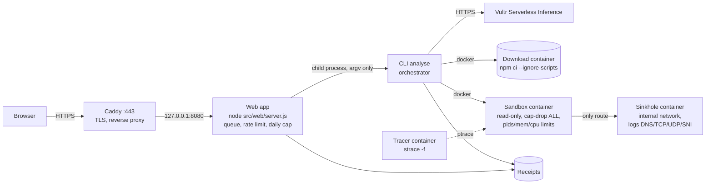

# Quarantine Package

Before you add an npm dependency, type its name and version. Quarantine Package downloads it **outside** a
sandbox without running any script. It then installs and loads it **inside** a disposable, hardened, traced
sandbox whose only network ends at a logging sinkhole. You get a public receipt with every attempt it observed
and a deterministic verdict: `install`, `review` or `do-not-install`.

A model on **Vultr Serverless Inference** reads the package first. It predicts what the package will do
(network, files outside its folder, child processes) and writes a short harness that exercises the package's
main API. The receipt puts that prediction next to what was really observed. The verdict never depends on the
model: fixed rules compute it from the kernel trace and the sinkhole log.

**Live demo:** https://qp.hugovaler.com (one Vultr VM). Example receipts:
[express → install](https://qp.hugovaler.com/r/514e574600) ·
[network demo → review](https://qp.hugovaler.com/r/d5af19b228) ·
[hostile package → do-not-install](https://qp.hugovaler.com/r/8b42cfb93e).

## The use case, and how the agent executes real tasks

Supply-chain attacks hide in install scripts and load-time code: they read tokens, write to system paths, and
send data out. Reading the code does not tell you what it will do; running it on your machine is the risk.

For each request, the system does the following:

1. **Download outside the sandbox.** `npm` resolves and fetches the exact tree with `--ignore-scripts`, with
   limits on size, dependency count and time. Only registry dependencies are allowed (no git, URL or file
   specs).
2. **Model step (Vultr Serverless Inference).** The model gets the package metadata and README and entry
   excerpts. It never gets the host environment. It returns a prediction, a harness and a short explanation.
3. **Run inside a fresh sandbox.** The container has a read-only root, a tmpfs owned by its own uid,
   `cap-drop ALL`, `no-new-privileges`, a non-root user, pids, memory and CPU limits, and a wall clock enforced
   with `docker kill`.
   - It runs `npm rebuild --offline` (the install scripts), then the product's own `require()` of the package,
     then the model's harness.
   - A separate tracer container follows every syscall with `strace`.
   - The sandbox's only network is an internal Docker network whose every route and DNS answer ends at the
     sinkhole. That covers TCP by name and by direct IP, UDP and DNS.
4. **Decide.** Fixed rules turn the observations into a verdict, for example a write outside the allowed
   areas, a credential path or key-like env read, or a network attempt carrying a payload. If any completeness
   check fails, the trace counts as incomplete and the verdict is at worst `review`.
5. **Destroy.** Every container, network and volume of the task is removed. The receipt records that nothing
   is left.
6. **Explain (informational).** A second model call describes what happened, from a summary built by code. A
   fixed guard replaces any reply that contradicts the verdict with a sentence built by code
   ([The two model texts](#the-two-model-texts)). The verdict is already written at this point.

## Vultr services used

| Service | What it does here |
|---|---|
| **Vultr Cloud Compute (VM)** | The whole backend: the web app (behind Caddy with TLS), the job queue, Docker with the sandbox, tracer and sinkhole containers, and the receipts. Vultr is where every task is controlled and run, not static hosting. |
| **Vultr Serverless Inference** | Every LLM call: the OpenAI-compatible endpoint `https://api.vultrinference.com/v1`, default model `mimo-v2.6-pro`, fallback `deepseek-v4.1-flash-1017`. The key (`VULTR_INFERENCE_KEY`) is read only by the backend process and sent only in the `Authorization` header. It is never logged, put in a receipt, sent to the browser, or passed into a sandbox. |

## Architecture



Everything above runs on one Vultr VM. Only Caddy is exposed, on ports 80 and 443. The web app listens on
`127.0.0.1:8080`. The sandbox network is `--internal`, so it has no route to the internet: the sinkhole is the
only place a package's traffic can reach.

**Isolation: hardened Docker today; gVisor is future work.** The sandbox is hardened Docker (runc: read-only root, no capabilities, non-root, pids/memory/CPU and wall-clock limits) with a kernel-level strace backstop. Running it under gVisor (runsc) is future work: under runsc the package's system calls are served by gVisor's user-space kernel, not by the host kernel, so observation would have to move to gVisor's own trace points, and we have not yet verified that this keeps every observation the verdict needs.

**Trust boundaries:**
- **Untrusted:** packages and everything they print or write, and model output. These are only observed, escaped, and judged by fixed rules.
- **Public surface:** only Caddy is reachable from the internet. The web app accepts a validated `name@version` or a demo id, and passes it to the CLI as argv, never through a shell. It has no admin or Docker route.
- **The backend user can drive Docker (L-14).** The service user `qp` is in the `docker` group, which is root-equivalent, so a compromise of the web process would be a host compromise.
  - Mitigations: the small attack surface above; systemd hardening (`NoNewPrivileges`, `ProtectSystem`, `ProtectHome`, `PrivateTmp`); the app bound to `127.0.0.1` behind Caddy; and the model key kept in a root-only `EnvironmentFile`.
  - Rootless Docker or a Docker socket proxy that allows only the needed calls is future work.

Deployment steps: [`docs/DEPLOY.md`](docs/DEPLOY.md). Interface details: [`docs/CONTRACT.md`](docs/CONTRACT.md).

## Where the containment moment is

Run the **"Hostile package"** demo card on the home page (a repo fixture, never published). Its install
script tries to:
- write to `/etc` and to the home directory;
- look for `docker.sock`;
- count key-like environment variables;
- `POST` data to `recolector.example.com`.

The receipt shows:
- the verdict **`do-not-install`**, with each attempt listed and the rule it fired;
- the exfiltration attempt **only in the sinkhole log**, with method, path and payload size, and nothing left
  the VM;
- **"Sandbox destroyed: yes"**.

`/healthz` keeps answering during the run, and the next analysis runs in a fresh sandbox.

Two more containment demos on the home page, both repo fixtures: a **fork bomb** stopped by the pids limit in
about 7 s ([receipt](https://qp.hugovaler.com/r/93b65a40ad)) and an **infinite loop** killed by the 60 s wall
clock ([receipt](https://qp.hugovaler.com/r/7480a24604)). Both get `do-not-install` (rule `e`, task ended by a
limit) and leave nothing behind.

[`docs/DEMO.md`](docs/DEMO.md) is the step-by-step demo script.

## Tried on real dependencies

Three dependencies of one of the author's own projects (a Fastify and Stellar payments app), run on the live
deployment on 4 Nov 2026:

| Package | Verdict | What it shows |
|---|---|---|
| `fastify@5.12.4` | [`install`](https://qp.hugovaler.com/r/d6fbf70332) in about 9 s | A real server framework passes: no network, no writes outside its folder, model prediction matches. |
| `esbuild@0.28.2` | [`review`](https://qp.hugovaler.com/r/ab40fb6263) | A package that runs a native binary as a long-lived child trips a completeness check, so it fails closed (L-16). |
| `@stellar/stellar-sdk@17.0.1` | aborted before running | Its tree is over the 50 MB download limit, so nothing is executed and no verdict is given (L-17). |

## Setup from a clean clone

**Requirements:**
- Docker (Docker Engine on Linux, or Docker Desktop);
- Node.js 22.12 or later, with npm.

The product has no npm runtime dependencies.

```sh
git clone <repo-url> quarantine-package && cd quarantine-package
npm run build:images                          # qp-sandbox / qp-sinkhole images (base images pinned by digest)
npm test                                      # unit tests (no Docker, fake model)
node src/cli.js analyse express@4.21.2        # registry package  -> install
node src/cli.js analyse --fixture hostile     # local fixture     -> do-not-install
node src/cli.js leftovers                     # expects count 0
node src/cli.js scan-secrets                  # pattern scan of the repo and receipts
npm run web                                   # web app on http://127.0.0.1:8080
```

On a Linux host, the preload's role check (H-1) demotes any test process that claims the harness role. So the
package-phase (latch) unit tests catch a latch regression only on a non-Linux host. When you change
`preload.cjs` or `harness.cjs`, also run `npm test` on a non-Linux host, or the runtime S2 suite.

To use the model, set `VULTR_INFERENCE_KEY` in the environment of the process that runs the CLI or the web
app. Without it, every analysis still runs and gets its verdict; the receipt says the model was not available.
`node src/cli.js smoke-model --out evidence/c11-smoke.json` is the one command that calls the real endpoint
on purpose. Measured on Vultr Serverless Inference (C11): the model answered for 4 of 4 packages
(`express`, `lodash`, `chalk` and the hostile fixture), with latencies from 1.9 s to 4.7 s.

Receipts are written to `./receipts/<taskId>.json` (override with `QP_RECEIPTS_DIR`). Docker objects are named
`ar-<QP_RUN_PREFIX>-<role>-<taskId>`.

## Use the result

Every receipt is available in four forms. All of them are built from the stored receipt only, so older receipts
get them too, with no re-run.

| Form | Where | What it is for |
|---|---|---|
| Page | `/r/<id>` | People. It has a **Copy for PR** button, a **Download JSON** link and links to the two forms below. |
| JSON | `/api/receipts/<id>` | The full receipt: every observation, the sinkhole log, the limits and the teardown. |
| Markdown | `/r/<id>.md` (`text/markdown`) | Pasting into a pull request comment. It lists the package and version, the verdict, each rule that fired, prediction vs observed, the sinkhole summary (host, method, path, bytes), "sandbox destroyed", the limitations that applied, and links to the page and the JSON. |
| SARIF 2.1.0 | `/api/receipts/<id>.sarif` (`application/sarif+json`) | Code scanning tools. |

The Markdown and SARIF forms contain **no model text**: they are deterministic. Every string the package controls
(paths, host names, URL paths) is shown inside an inline code span, with control, bidi and zero-width characters
written out as `\u{..}` and long strings cut. So a package cannot forge a verdict line, a link, an image, a
mention or HTML in your PR comment. Set `QP_PUBLIC_URL` (for example `https://qp.example.com`) for absolute links.

**SARIF.** There is one rule per verdict rule `a` to `i`, and one result per rule that fired. All results take
the level of the **verdict**: `error` for `do-not-install` and `warning` for `review`. So a `do-not-install`
receipt can have `review`-tier rules reported as `error`, and an `install` receipt has no results. Each result is
located at the analysed package's `package.json`, because GitHub code scanning requires a location for every
result ([SARIF support for code scanning](https://docs.github.com/en/code-security/code-scanning/integrating-with-code-scanning/sarif-support-for-code-scanning)).
The output is validated against the OASIS SARIF 2.1.0 JSON schema in the unit tests.

**CLI.** `node src/cli.js analyse <spec> --format json|md|sarif` writes that form to stdout and still writes the
receipt file. `node src/cli.js export <receipt.json> --format json|md|sarif` converts a stored receipt.
`analyse` and `export` both exit with the verdict:

| Exit | Meaning |
|---|---|
| `0` | `install` |
| `10` | `review` |
| `20` | `do-not-install` |
| `2` | usage error or invalid input (no verdict) |
| `3` | aborted in the download phase, for example a non-registry dependency or a size limit (no verdict) |
| `4` | infrastructure failure or tracer unavailable (no verdict) |
| `130` | interrupted with Ctrl+C or `SIGTERM` (no verdict) |

A GitHub Actions step that fails the job on `do-not-install`. This is an example only; the runner needs Docker
and a clone of this repository with the images built.

```yaml
- name: Quarantine the new dependency
  run: |
    code=0; node src/cli.js analyse "lodash@4.17.21" --format md > qp.md || code=$?
    cat qp.md >> "$GITHUB_STEP_SUMMARY"
    if [ "$code" -eq 20 ]; then echo "::error::do-not-install"; exit 1; fi
    if [ "$code" -ne 0 ] && [ "$code" -ne 10 ]; then exit "$code"; fi
```

### The two model texts

The receipt page shows two texts written by the model. Neither one can change the verdict.

- **Model's expectation before the run** is written before the sandbox runs, from the package metadata, README
  and entry excerpts. It goes with the prediction and the harness.
- **What happened (model, informational)** is written after the verdict is computed and the sandbox is destroyed.
  It comes from a second Vultr Serverless Inference call. The model gets a summary built by code: the verdict, the
  rules that fired, counts per observation kind, up to 8 representative observations, the sinkhole summary and
  prediction vs observed. Every string the package controls is capped and passed as quoted data inside a delimited
  JSON block that the prompt declares untrusted. The redactor runs on the input and the output.

A fixed guard checks the reply. Any doubt replaces it with a sentence built by code from the receipt, labelled
*code template*. The guard rejects a reply that:
- names a verdict other than the computed one;
- says or implies safe, harmless, clean, no risk and similar when the verdict is not `install`;
- cites a rule letter that did not fire;
- is longer than 4 sentences or 600 characters;
- holds markup, links, line breaks or non-ASCII text after normalisation;
- or comes from a call that failed or timed out (20 s).

The receipt records which text was used and why (`outcomeExplanation.source` and `guard.reason`). With
`QP_MODEL_OFF=1` the template is always used. `verdict.js` never reads this field, and a unit test checks that.

The receipt with the verdict is written first, with `outcomeExplanation.status: "pending"`. The call then runs,
and the receipt file is replaced atomically with the result. The web job finishes when the CLI exits, so the job
page links to the final receipt. If the CLI is interrupted during the call, the receipt keeps the verdict and stays
`pending`. Receipts made before this feature have no such field and render as before.

## Default limits

| Phase | Limit |
|---|---|
| Download | 120 s, 50 MB unpacked, 300 packages, registry dependencies only |
| Sandbox | 60 s wall clock, 64 pids, 256 MB memory (no swap), 0.5 CPU, tmpfs 128 MB `/work`, 64 MB `/tmp`, 16 MB HOME |
| Web | queue concurrency 1 (max 2), 5 analyses per client per 10 min (IPv6 per /64), 30 per 10 min overall, a daily cap on model calls |

## Stopping a run

Ctrl+C (or `SIGTERM`) stops `analyse` at once. It removes every container, network and volume of the task
within 10 s, writes a receipt with `abortReason: interrupted` and exits with 130. A second Ctrl+C does not
skip the teardown. If the CLI is killed outright, the per-task watchdog removes the objects. Stopping the web
server interrupts its running tasks the same way.

## Debugging a verdict

Set `QP_KEEP_TRACE=1` to keep the sandbox's raw syscall trace as `<taskId>.trace` next to the receipt. The
receipt only names the file. Lines that look like secrets are redacted, and `scan-secrets` checks these files.

## Known limitations

Every receipt lists these in `knownLimitations`.
- **Fail-closed entries:** most entries can only make a verdict stricter: `review` or `do-not-install` for
  something benign.
- **Two exceptions:** L-1 and L-13 can miss a key **read** that leaves no record. L-13 also covers a native addon
  that uses a file syscall strace 6.1 cannot name (see its row).
  - The sandbox holds no secret values, which the C7 scan checks on every run.
  - Any attempt to send data out is still caught by the sinkhole and its rules.
  - What is lost is only the "tried to read a key" signal.

| Id | Limitation |
|---|---|
| L-1 | Env reads inside the shell (`$NPM_TOKEN` expanded by a lifecycle `sh`) are invisible to both the kernel trace and the preload. `perl` and `awk` are removed from the image. The shell's file, network and process activity is still traced and judged. |
| L-2 | A lifecycle that runs a script directly from `/work`, `/tmp` or HOME (`./install.sh`) gets `review`. The trace cannot tell a script from an ELF binary there, so it fails closed. |
| L-3 | A non-registry dependency deep in the tree is rejected before it is fetched. Registry metadata of the dependencies visited before it has already been fetched by then. |
| L-4 | Not inspected: ICMP and TLS bodies; only the SNI is recorded. The tracer is visible to the package. `execveat` is covered by unit tests only. Image builds are not byte-reproducible, because distribution packages are installed at build time. |
| L-6b | When a child's relative file operations appear in the trace before its parent's clone return, they are unresolved. Those writes give `do-not-install` and those reads give `review` (fail closed). |
| L-7 | **Fixed.** A thread's `chdir` racing a fork could misattribute a child's working directory. A structural rule now leaves such a child's directory unresolved. Measured on real runs: 0 misses in 15 real attempts in S1, and 0 in 3 in S2. The residuals are L-8 and L-8b. |
| L-8 | When a thread not yet attributed to any process changes directory during an unrelated fork, the child's relative paths are unresolved. This can over-condemn but never gives `install`. |
| L-8b | In a multi-threaded package, if a thread other than the forking one ever changes directory, the children's relative paths are unresolved. Relative writes give `do-not-install` and relative reads give `review`. This is fail-closed by design. |
| L-9 | A `chdir` with an unknown outcome (killed mid-call, or still unfinished when the trace ends) is treated as applied, so the affected working directories become unresolved (fail closed). |
| L-10 | **Fixed.** When a non-thread process is cloned with `CLONE_FS`, both it and its parent get an unresolved working directory for the whole trace, whatever the print order (fail closed). Only native code makes such clones. |
| L-11 | `io_uring` is not traced. Node in the sandbox never uses it, and the default Docker seccomp profile denies it to native code. |
| L-13 | A native addon (`.node`) loaded by the package can read env variables without leaving a record. Only the "tried to read a key" signal is lost. Extension (S6): native addon + syscalls strace 6.1 cannot name. The tracer's strace 6.1 cannot trace syscalls above 450 by name or number, so file calls added in newer kernels (`fchmodat2`, `setxattrat`/`getxattrat`/`listxattrat`/`removexattrat`, `open_tree_attr`, `file_getattr`/`file_setattr`) are not observed. glibc 2.36 has no wrappers for them and the image has no binary that uses them, so only a native addon can make them. |
| L-14 | The web service user is in the `docker` group, which is root-equivalent, so a compromise of the web process would be a host compromise. Mitigations: no admin or Docker route, argv-only calls (never a shell), systemd hardening, and the app bound to 127.0.0.1 behind Caddy. Rootless Docker or a socket proxy is future work. |
| L-15 | Test-only, not a product limitation. On a Linux host (such as the node 22 deploy VM), the preload's role check (H-1) demotes the test process, so the latch unit tests cannot detect a latch regression (S2j/S2k). Any change to `preload.cjs` or `harness.cjs` needs a unit run on a non-Linux host (the developer's node 24 run) plus the runtime S2 suite. |
| L-16 | A package whose API keeps a native child process running (for example `esbuild`) can leave a completeness marker missing, which gives `review` for a benign package. Fail closed. |
| L-17 | Large dependency trees (over 50 MB unpacked or 300 packages, for example `@stellar/stellar-sdk`) are aborted at download with no verdict. The limits fit a 4 GB VM and are configurable. |
| L-18 | The receipt page shows at most 300 observations and 200 sinkhole entries. When it cuts a list, it says "showing N of M" and links to the full receipt JSON at `/api/receipts/<id>`. |
| L-19 | **Fixed** (S6, commits e3edf74..265f148; the fix is complete at 265f148, e3edf74 alone was rejected in review). The tracer missed file syscalls outside its hand-written list (`utimensat`, `fchownat`, `readlink`, `inotify_add_watch` and others), so a package whose only forbidden acts used them got `install`. The traced set is now strace 6.1's whole `%file` class (minus `getcwd`) plus the fd-only file calls, every traced call has a mapping or fails closed, and a unit test checks both against an independent reference list ([`docs/TRACE-SET.md`](docs/TRACE-SET.md)). |
| L-20 | The "What happened" guard is lexical: it checks fixed English phrase lists and rule-letter forms. It fails closed, so a correct reply is sometimes replaced by the code template. A reply that passes can still be odd or incomplete; it is labelled informational and never affects the verdict, the Markdown or the SARIF. If the CLI is interrupted during the call, the receipt stays `pending`. |
| H-1 | **Done.** The `QP_ROLE` role label is checked as defence in depth: it is honoured only for the real product entry point started by the stage script. The verdict takes process roles from the kernel trace in any case. |

Further notes are in each receipt's `knownLimitations` and in [`docs/CONTRACT.md`](docs/CONTRACT.md).

## How this was built

This project was developed with Claude Code, by a band of coding agents in separate roles: an implementer, an
adversary, an auditor and an analyst. A human operator dispatched each stage, deployed it and handled the
secrets. The agents wrote the code, the tests and these documents. Each stage was accepted only after an
independent auditor reproduced its criteria on a clean clone.

The product's own agent, the model step that predicts behaviour and writes the harness, makes all of its LLM
calls through Vultr Serverless Inference, and through nothing else. The CLI and the web app call no other model
provider.

## License

MIT, see [LICENSE](LICENSE).
- The product has no npm runtime dependencies.
- The JavaScript the sandbox image loads at runtime is `npm-package-arg` and `pacote` from the npm bundled in
  the official Node image. Their whole tree is MIT-compatible: 130 modules, all MIT, ISC, BSD, Apache-2.0,
  BlueOak-1.0.0 or CC0/CC-BY. This is checked by `node scripts/license-check.js`, with the result in
  [`docs/licenses.json`](docs/licenses.json).
- System tools in the images are separate programs we invoke, not code we link or redistribute: `npm`,
  `strace`, `iptables`, `tcpdump` and Python.
