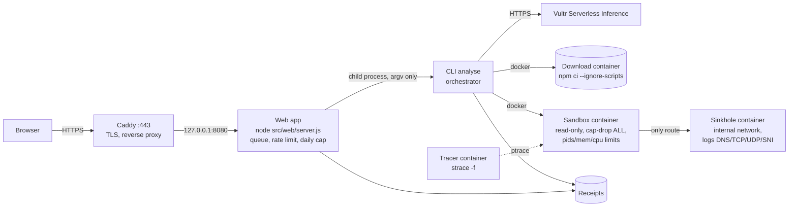

# Quarantine Package

Before you add an npm dependency, type its name and version. Quarantine Package downloads it **outside** a
sandbox without running any script. It then installs and loads it **inside** a disposable, hardened, traced
sandbox whose only network ends at a logging sinkhole. You get a public receipt with every attempt it observed
and a deterministic verdict: `install`, `review` or `do-not-install`.

A model on **Vultr Serverless Inference** reads the package first. It predicts what the package will do
(network, files outside its folder, child processes) and writes a short harness that exercises the package's
main API. The receipt puts that prediction next to what was really observed. The verdict never depends on the
model: fixed rules compute it from the kernel trace and the sinkhole log.

## The use case, and how the agent executes real tasks

Supply-chain attacks hide in install scripts and load-time code: they read tokens, write to system paths, and
send data out. Reading the code does not tell you what it will do; running it on your machine is the risk.

For each request, the system does the following:

1. **Download outside the sandbox.** `npm` resolves and fetches the exact tree with `--ignore-scripts`, with
   limits on size, dependency count and time. Only registry dependencies are allowed (no git, URL or file
   specs).
2. **Model step (Vultr Serverless Inference).** The model gets the package metadata and README and entry
   excerpts. It never gets the host environment. It returns a prediction, a harness and a short explanation.
3. **Run inside a fresh sandbox.** The container has a read-only root, a tmpfs owned by its own uid,
   `cap-drop ALL`, `no-new-privileges`, a non-root user, pids, memory and CPU limits, and a wall clock enforced
   with `docker kill`.
   - It runs `npm rebuild --offline` (the install scripts), then the product's own `require()` of the package,
     then the model's harness.
   - A separate tracer container follows every syscall with `strace`.
   - The sandbox's only network is an internal Docker network whose every route and DNS answer ends at the
     sinkhole. That covers TCP by name and by direct IP, UDP and DNS.
4. **Decide.** Fixed rules turn the observations into a verdict, for example a write outside the allowed
   areas, a credential path or key-like env read, or a network attempt carrying a payload. If any completeness
   check fails, the trace counts as incomplete and the verdict is at worst `review`.
5. **Destroy.** Every container, network and volume of the task is removed. The receipt records that nothing
   is left.

## Vultr services used

| Service | What it does here |
|---|---|
| **Vultr Cloud Compute (VM)** | The whole backend: the web app (behind Caddy with TLS), the job queue, Docker with the sandbox, tracer and sinkhole containers, and the receipts. Vultr is where every task is controlled and run, not static hosting. |
| **Vultr Serverless Inference** | Every LLM call: the OpenAI-compatible endpoint `https://api.vultrinference.com/v1`, default model `mimo-v2.6-pro`, fallback `deepseek-v4.1-flash-1017`. The key (`VULTR_INFERENCE_KEY`) is read only by the backend process and sent only in the `Authorization` header. It is never logged, put in a receipt, sent to the browser, or passed into a sandbox. |

## Architecture



Everything above runs on one Vultr VM. Only Caddy is exposed, on ports 80 and 443. The web app listens on
`127.0.0.1:8080`. The sandbox network is `--internal`, so it has no route to the internet: the sinkhole is the
only place a package's traffic can reach.

Deployment steps: [`docs/DEPLOY.md`](docs/DEPLOY.md). Interface details: [`docs/CONTRACT.md`](docs/CONTRACT.md).

## Where the containment moment is

Run the **"Hostile package (repo fixture)"** demo on the home page. Its install script tries to:
- write to `/etc` and to the home directory;
- look for `docker.sock`;
- count key-like environment variables;
- `POST` data to `recolector.example.com`.

The receipt shows:
- the verdict **`do-not-install`**, with each attempt listed and the rule it fired;
- the exfiltration attempt **only in the sinkhole log**, with method, path and payload size, and nothing left
  the VM;
- **"Sandbox destroyed: yes"**.

`/healthz` keeps answering during the run, and the next analysis runs in a fresh sandbox.
[`docs/DEMO.md`](docs/DEMO.md) is the step-by-step demo script.

## Setup from a clean clone

**Requirements:**
- Docker (Docker Engine on Linux, or Docker Desktop);
- Node.js 22.12 or later, with npm.

The product has no npm runtime dependencies.

```sh
git clone <repo-url> quarantine-package && cd quarantine-package
npm run build:images                          # qp-sandbox / qp-sinkhole images (base images pinned by digest)
npm test                                      # unit tests (no Docker, fake model)
node src/cli.js analyse express@4.21.2        # registry package  -> install
node src/cli.js analyse --fixture hostile     # local fixture     -> do-not-install
node src/cli.js leftovers                     # expects count 0
node src/cli.js scan-secrets                  # pattern scan of the repo and receipts
npm run web                                   # web app on http://127.0.0.1:8080
```

To use the model, set `VULTR_INFERENCE_KEY` in the environment of the process that runs the CLI or the web
app. Without it, every analysis still runs and gets its verdict; the receipt says the model was not available.
`node src/cli.js smoke-model --out evidence/c11-smoke.json` is the one command that calls the real endpoint
on purpose.

Receipts are written to `./receipts/<taskId>.json` (override with `QP_RECEIPTS_DIR`). Docker objects are named
`ar-<QP_RUN_PREFIX>-<role>-<taskId>`.

## Default limits

| Phase | Limit |
|---|---|
| Download | 120 s, 50 MB unpacked, 300 packages, registry dependencies only |
| Sandbox | 60 s wall clock, 64 pids, 256 MB memory (no swap), 0.5 CPU, tmpfs 128 MB `/work`, 64 MB `/tmp`, 16 MB HOME |
| Web | queue concurrency 1 (max 2), 5 analyses per client per 10 min (IPv6 per /64), 30 per 10 min overall, a daily cap on model calls |

## Stopping a run

Ctrl+C (or `SIGTERM`) stops `analyse` at once. It removes every container, network and volume of the task
within 10 s, writes a receipt with `abortReason: interrupted` and exits with 130. A second Ctrl+C does not
skip the teardown. If the CLI is killed outright, the per-task watchdog removes the objects. Stopping the web
server interrupts its running tasks the same way.

## Debugging a verdict

Set `QP_KEEP_TRACE=1` to keep the sandbox's raw syscall trace as `<taskId>.trace` next to the receipt. The
receipt only names the file. Lines that look like secrets are redacted, and `scan-secrets` checks these files.

## Known limitations

Every receipt lists these in `knownLimitations`.
- **Fail-closed entries:** most entries can only make a verdict stricter: `review` or `do-not-install` for
  something benign.
- **Two exceptions:** L-1 and L-13 can miss a key **read** that leaves no record.
  - The sandbox holds no secret values, which the C7 scan checks on every run.
  - Any attempt to send data out is still caught by the sinkhole and its rules.
  - What is lost is only the "tried to read a key" signal.

| Id | Limitation |
|---|---|
| L-1 | Env reads inside the shell (`$NPM_TOKEN` expanded by a lifecycle `sh`) are invisible to both the kernel trace and the preload. `perl` and `awk` are removed from the image. The shell's file, network and process activity is still traced and judged. |
| L-2 | A lifecycle that runs a script directly from `/work`, `/tmp` or HOME (`./install.sh`) gets `review`. The trace cannot tell a script from an ELF binary there, so it fails closed. |
| L-3 | A non-registry dependency deep in the tree is rejected before it is fetched. Registry metadata of the dependencies visited before it has already been fetched by then. |
| L-4 | Not inspected: ICMP and TLS bodies; only the SNI is recorded. The tracer is visible to the package. `execveat` is covered by unit tests only. Image builds are not byte-reproducible, because distribution packages are installed at build time. |
| L-6b | When a child's relative file operations appear in the trace before its parent's clone return, they are unresolved. Those writes give `do-not-install` and those reads give `review` (fail closed). |
| L-7 | A thread's `chdir` racing a fork could misattribute a child's working directory. This is fixed by a structural rule, and the race is measured on real runs: 0 misses in 15 real attempts in S1 and 0 in 3 in S2. The residuals are L-8 and L-8b. |
| L-8 | When a thread not yet attributed to any process changes directory during an unrelated fork, the child's relative paths are unresolved. This can over-condemn but never gives `install`. |
| L-8b | In a multi-threaded package, if a thread other than the forking one ever changes directory, the children's relative paths are unresolved. Relative writes give `do-not-install` and relative reads give `review`. This is fail-closed by design. |
| L-9 | A `chdir` with an unknown outcome (killed mid-call, or still unfinished when the trace ends) is treated as applied, so the affected working directories become unresolved (fail closed). |
| L-10 | When a non-thread process is cloned with `CLONE_FS`, both it and its parent get an unresolved working directory (fail closed). Only native code makes such clones. |
| L-11 | `io_uring` is not traced. Node in the sandbox never uses it, and the default Docker seccomp profile denies it to native code. |
| L-13 | A native addon (`.node`) loaded by the package can read env variables without leaving a record. Only the "tried to read a key" signal is lost. |
| H-1 | The `QP_ROLE` role label is checked as defence in depth: it is honoured only for the real product entry point started by the stage script. The verdict takes process roles from the kernel trace in any case. |

Further notes are in each receipt's `knownLimitations` and in [`docs/CONTRACT.md`](docs/CONTRACT.md).

## License

MIT, see [LICENSE](LICENSE).
- The product has no npm runtime dependencies.
- The JavaScript the sandbox image loads at runtime is `npm-package-arg` and `pacote` from the npm bundled in
  the official Node image. Their whole tree is MIT-compatible: 130 modules, all MIT, ISC, BSD, Apache-2.0,
  BlueOak-1.0.0 or CC0/CC-BY. This is checked by `node scripts/license-check.js`, with the result in
  [`docs/licenses.json`](docs/licenses.json).
- System tools in the images are separate programs we invoke, not code we link or redistribute: `npm`,
  `strace`, `iptables`, `tcpdump` and Python.
